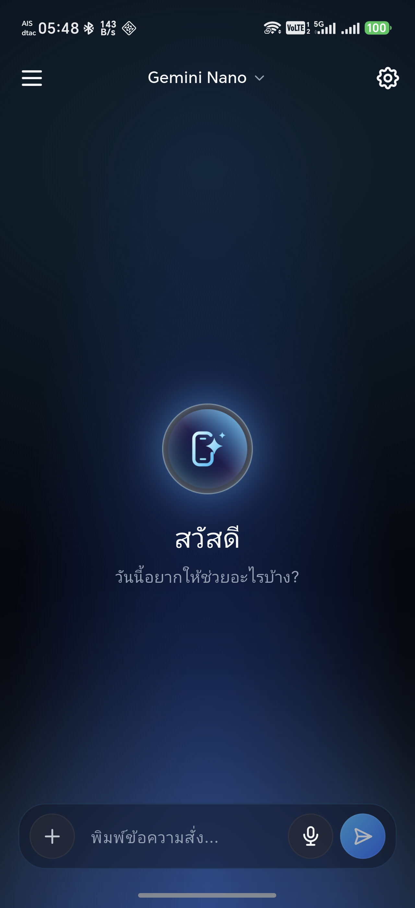
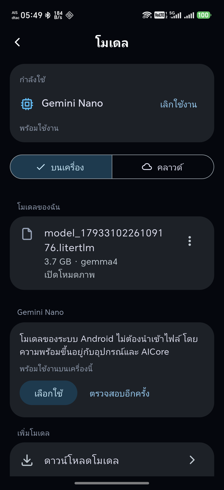
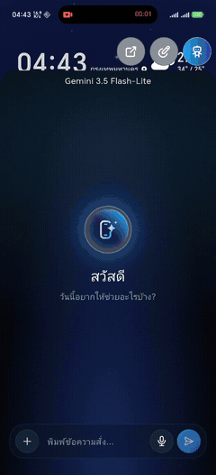
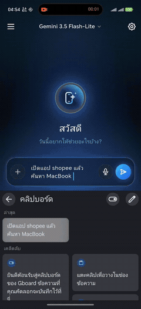
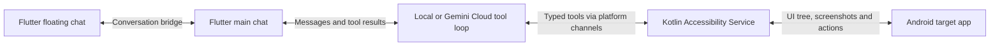

# MobilePilot

MobilePilot is an Android AI agent that turns chat instructions into actions on your phone. Ask it to open an app, find a screen element, or enter a search query, then follow its tool steps and stop the task from the main chat or floating overlay.

## Screenshots

 

## Demos

| YouTube · 16 s | Shopee · 19 s |
| --- | --- |
|  |  |
| The floating chat collapses when Gemini starts using tools, and YouTube opens *Chill Lofi Mix*. [Full video](doc/demos/MobilePilot-YouTube.mp4) | Gemini opens Shopee and searches for `MacBook` while the floating bubble shows progress. [Full video](doc/demos/MobilePilot-Shopee.mp4) |

Both clips were recorded on an Android phone and edited for length. They show the destinations reached in those runs.

## Features

- **Android device tools** for launching apps, reading the accessibility tree, waiting for UI changes, and performing supported text, tap, and gesture actions.
- **Local and cloud models.** Import or download compatible LiteRT-LM models, use Gemini Cloud through Firebase AI Logic, or try Gemini Nano on supported devices.
- **Floating chat** with the same active conversation and model as the main app. Send messages, choose an app when the agent asks, inspect tool steps, stop a run, or return to the main app.
- **Persistent chat** with conversation search, drafts, image and file attachments, and retry. The interface supports Thai and English and light and dark themes.

## Architecture



The Android layer checks that a UI reference still matches the target before using it. An accepted gesture and a verified outcome are tracked separately. The floating chat runs in a separate Flutter engine and shares conversation state through a native bridge.

[Project structure](doc/architecture.md) · [AI tool guide](doc/AI-Tool-Guide.md)

## Run locally

1. Install Flutter with Dart **3.13.7** or newer within Dart 3, plus the Android SDK. MobilePilot requires **Android 11 (API 30)** or newer. Use a physical device for cross-app control.
2. Create a Firebase project, register the Android package `com.example.mobile_pilot`, and run `flutterfire configure` for that project. Generate `lib/firebase_options.dart` and place `google-services.json` in `android/app/`. These local configuration files are ignored by Git.
3. For Gemini Cloud, enable Firebase AI Logic and configure App Check. Debug builds use a registered App Check debug token. Release builds use Play Integrity. Keep debug tokens private.
4. Connect the device and run:

   ```sh
   flutter pub get
   flutter run
   ```

5. Choose a model from the chat header or Settings. For device actions, enable the MobilePilot service in Android Accessibility settings. Enable the floating window in MobilePilot settings to use chat while another app is open.

For local inference, import a compatible `.litertlm` file or select a model from the download catalog.

## Model limitations

| Model | What to expect in MobilePilot |
| --- | --- |
| **LiteRT-LM (on-device)** | Model files require local storage, and speed depends on the device and model. Image input is available when the loaded model supports it. In recorded Gemma trials, some multi-step tasks took longer, repeated tool calls, or ended without a verified result. |
| **Gemini Nano (on-device, experimental)** | Availability depends on device support and AICore. In the tested integration, inference requires MobilePilot to be the foreground app. Once another app takes the foreground, the floating bubble alone cannot keep Nano inference running. |
| **Gemini Cloud (Firebase AI Logic)** | Requires network access, working Firebase and App Check setup, and available model quota. Requests are processed in the cloud. Screen images are sent only when cloud screenshot sharing is enabled. |

**LiteRT-LM context on the test device.** On a Snapdragon 8 Elite phone with 12 GB RAM, 8K tokens was the practical context setting when running tasks that involved multiple apps. Higher settings may cause MobilePilot to close unexpectedly in the same scenario. Start at 8K for cross-app tasks. The usable context depends on the model and available memory.

The [model test notes](doc/Model-Testing-Results.md) describe the individual runs and their testing conditions.

## Testing and limits

```sh
flutter analyze
flutter test
```

- Device-control outcomes depend on the target app, accessibility data, Android version, and permissions. The demos are individual observed runs. The roadmap tracks a repeatability target of at least 9 successful runs out of 10 for the same workflow.
- Background execution depends on Android and the selected model. The task journal can report interruptions after reopening.
- UI text and screenshots can contain private data. When using cloud models, review the available screenshot-sharing settings and use harmless tasks for demos. Per-action approvals for consequential actions are planned.

[Testing evidence](doc/Testing.md) · [Model testing](doc/Model-Testing-Results.md) · [Roadmap](doc/MobilePilot-Plan.md) · [Action risk policy](doc/Action-Risk-Policy.md)
